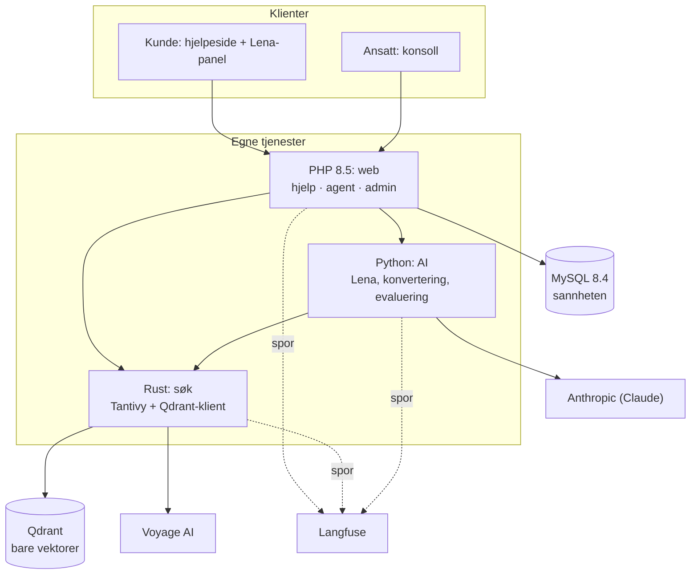
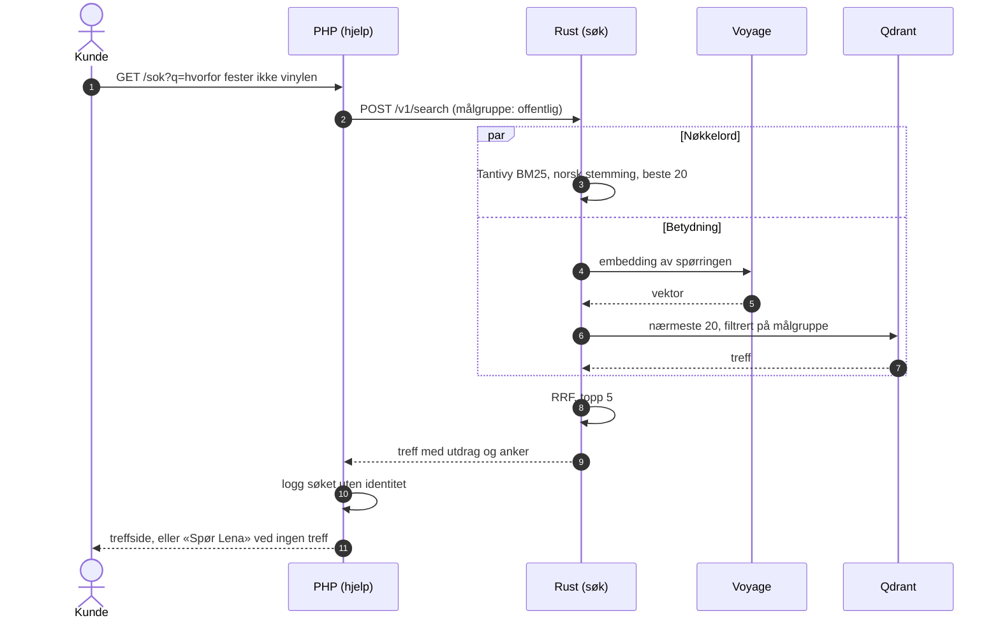
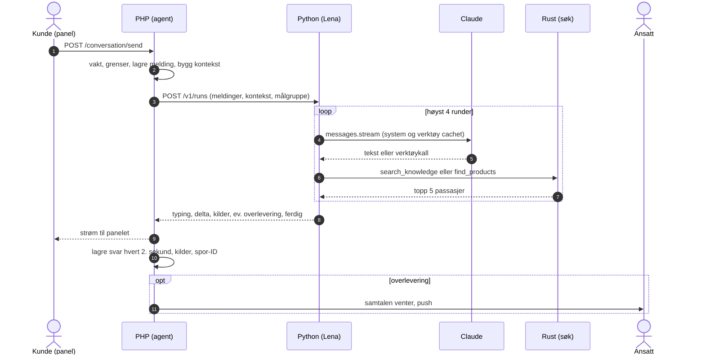
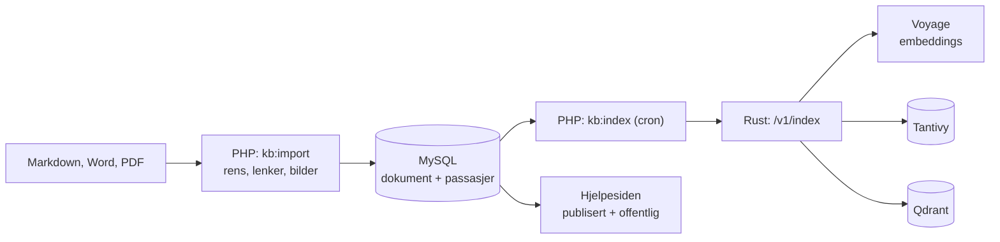

# CreativeArt hjelpesenter + Lena: arkitektur og flyt

Status: forslag, 15. november 2026. Besluttet samme dag: bygges som eget prosjekt (se 11).

Grunnlag: presentasjonen «AI-assistant for CreativeArt» (20 lysbilder med notater), `ca-web.md`, skissen av hjelpesiden, creativeart.no, og de sju Markdown-filene + PDF-en i denne mappen.

## 1. Konklusjon

1. Arkitekturen i presentasjonen er god og beholdes som ryggrad: MySQL er sannheten, Qdrant er en utledet indeks som kan bygges på nytt, søket er hybrid, Lena har få og smale verktøy, og hun gir fra seg samtalen i stedet for å gjette.
2. Hjelpesiden passer inn som et tredje nettsted i samme PHP-kodebase. Den krever tre endringer: kunnskapskildene må få publiseringsdata (i dag har en kilde bare tittel og tekst), søket må bli én delt tjeneste som både hjelpesiden og Lena bruker, og det må skrives mer innhold (dagens filer dekker én av fem kategorier i skissen).
3. PHP + Rust + Python er forsvarlig bare med strenge grenser. Forslaget: PHP eier web og data, Rust eier søk, Python eier alt som snakker med Claude. Hver tjeneste har én type tilstand og én ekstern nøkkel.
4. Langfuse fyller det hullet presentasjonen selv peker på (lysbilde 20: evalueringssett, «hvordan måler man om et AI-svar er godt nok?»).
5. Størst risiko, i denne rekkefølgen: motsigelser i innholdet (Lena vil gjengi dem), tre verktøykjeder for et lite team, personvern når samtaletekst sendes til Langfuse, og at Anthropic-nøkkelen utløper etter 30 dager.

## 2. Vurdering av arkitekturen i presentasjonen

### Behold

| Valg | Hvorfor det er riktig |
|---|---|
| MySQL eier all tekst, Qdrant bare vektorer (`kb:reindex`) | Én sannhet. En ødelagt indeks er aldri datatap |
| Hybrid søk med RRF, og nøkkelord alene hvis Qdrant feiler | Fagord og produktnavn treffer på nøkkelord, omskrivinger på vektor. Feil gir dårligere søk, ikke nedetid |
| Tre verktøy, høyst fire runder, siste runde uten verktøy | Løkka er begrenset og alltid ender i et svar |
| `hand_over_to_staff` for ordre, betaling, reklamasjon | Lena ser ikke dataene, så hun kan ikke dikte dem |
| Besøkende er ikke brukere; identitet bare fra det Shopify signerer | Ingen sesjon å stjele, ingenting nettleseren kan påstå |
| Produktkort fylles ved visning | En gammel melding viser dagens pris |
| Ekte database og HTTP i test, falske eksterne tjenester | Overlevering og feil kan testes uten å kalle Claude |
| Lås ved avsluttet emne, 14 dagers vindu | Konteksten er begrenset og forutsigbar |

### Svakheter og hull

| # | Funn | Konsekvens | Tiltak her |
|---|---|---|---|
| 1 | En kunnskapskilde er tittel + tekst (skjermbildet på lysbilde 11). Ingen kategori, målgruppe, status eller slug | Kan ikke drive en hjelpeside, og skiller ikke «bare for Lena» fra «offentlig» | Utvidet datamodell, se 5 |
| 2 | «Bruk som kunnskap» gjør en samtale til en kilde | Kundetekst kan havne på en offentlig side | Nye kilder er alltid utkast og interne til en ansatt publiserer |
| 3 | MySQL FULLTEXT har ikke norsk stemming | «vinylen» treffer ikke «vinyl». Merkes mest i et søkefelt, der kunden skriver ett eller to ord | Søketjeneste med norsk stemming, prefiks og synonymer |
| 4 | Ingen terskel for relevans (lysbilde 10) | Greit for Lena, som kan overse dårlige passasjer. På en treffside vises fem treff også for et meningsløst søk | Eget «ingen gode treff»-utfall. Terskel settes med evalueringssettet, ev. med Voyage rerank |
| 5 | Oppdeling på 2000 tegn kan dele en tabell eller en nummerert prosedyre | «Maks 2 hoderens per dag» kan skilles fra steget det gjelder | Del aldri inne i tabell eller nummerert liste |
| 6 | Hele verktøyløkka kjører i PHP | Hver aktive kjøring binder en PHP-arbeider i opptil fire modellrunder. Ikke et problem ved dagens volum, men første grense | Løkka flyttes til Python. Se 6.2 for hva som gjenstår |
| 7 | Grensen er 20 meldinger per enhet | Et nytt enhetstoken er gratis. Med en betalt modell bak er dette en kostnadsrisiko | Legg til tak per IP og et globalt dagsbudsjett |
| 8 | Ingen sporing eller evaluering | Ingen kan si om en endring i prompt, oppdeling eller søk gjorde svarene bedre | Langfuse, se 7 |
| 9 | Testlenken i `ca-web.md` har nøkkelen i URL-en | Havner i logger, historikk og Referer | Bytt nøkkel før lansering, flytt til header |
| 10 | Personvern er uavklart (lysbilde 20) | Langfuse blir et nytt sted der samtaletekst lagres | Bare metadata til Langfuse inntil lagringstid er bestemt |

## 3. Målarkitektur

### Prinsipper

1. PHP er eneste dør mot internett. Rust og Python lytter bare internt.
2. Én type tilstand per tjeneste: PHP eier MySQL, Rust eier indeksene, Python er tilstandsløs.
3. Én nøkkel per tjeneste: Anthropic bare i Python, Voyage bare i Rust, Shopify/Pusher/VAPID bare i PHP.
4. Ett søk, to forbrukere: hjelpesiden og Lena kaller samme `/v1/search`. Da finner de alltid det samme.
5. Selvbetjening først: hjelpesiden skal virke uten Claude.
6. Målgruppe avgjøres av PHP og håndheves i søket, aldri av modellen.



Avhengighetene går én vei: PHP → Python → Rust, og PHP → Rust. Rust kjenner ingen av de andre. Python kaller aldri PHP.

### Hvem gjør hva

| Tjeneste | Språk | Ansvar | Tilstand | Nøkkel |
|---|---|---|---|---|
| `web` | PHP 8.5, Twig, vanilla JS | Tre nettsteder via `hostmap.php`: `hjelp` (ny), `agent`, `admin`. Vakter, grenser, identitet, oppdeling i passasjer, cron | MySQL 8.4 | Ingen i første versjon. Senere: Shopify, Pusher, VAPID |
| `search` | Rust (axum, tantivy, qdrant-client) | Indeksere passasjer, hybrid søk, forslag mens kunden skriver | Tantivy på disk + Qdrant, begge utledet | Voyage |
| `agent` | Python (FastAPI, anthropic) | Lena-kjøringer med verktøyløkke, PDF til Markdown, evalueringer | Ingen | Anthropic |

### Hvorfor akkurat disse språkene

Presentasjonen kaller stakken «bevisst kjedelig». Rust og Python bryter med det, så hver må forsvare plassen sin.

- PHP: det presentasjonen allerede har. Hjelpesiden er server-rendret HTML, som er det PHP og Twig gjør best, og det gir søkemotorer ferdig innhold.
- Rust: ved dagens volum trengs ikke Rust for fart. Plassen forsvares av at søket er den ene delen begge inngangene deler, og av at Tantivy gir norsk stemming, prefikssøk, skrivefeiltoleranse og utheving av treff, som MySQL FULLTEXT mangler. Qdrant har offisiell Rust-klient.
- Python: løkka kunne blitt i PHP, siden Anthropics PHP-SDK har både verktøyløkke og OpenTelemetry. Python velges fordi evalueringene uansett må skrives der (Langfuse har SDK for datasett og eksperimenter i Python og JS). Da kjører evalueringen nøyaktig samme kode som produksjon.

Prisen er tre verktøykjeder. Den holdes nede med to smale kontrakter i `contracts/` (JSON Schema), kontraktstester i hver tjeneste, og `make check` som kjører alle tre.

## 4. Kundens flyt: fra hjelpeside til menneske

Hjelpesiden er inngangen. Chat er neste trinn, ikke første.

| Nivå | Hvor | Koster | Løser |
|---|---|---|---|
| 0 | Hjelpesiden: søk, kategorier, populære spørsmål, artikler | Ingenting per visning | Det som står i guidene |
| 1 | Lena i sidepanelet | Claude-kall | Spørsmål som krever sammenstilling eller oppfølging |
| 2 | Ansatt i konsollen | Tid | Ordre, betaling, reklamasjon, og alt Lena er usikker på |

### 4.1 Hjelpesiden

1. `GET /` rendres av PHP: søkefelt, kategorikort, populære spørsmål, «Fant du ikke svaret? Start chat».
2. Et kategorikort vises bare hvis kategorien har minst én publisert artikkel.
3. Populære spørsmål er en kuratert liste i MySQL. Hvert spørsmål peker på en passasje. Svarteksten er skrevet eller godkjent av en ansatt og lagret, ikke generert ved visning.
4. Mens kunden skriver: `GET /sok/forslag?q=` → Rust `/v1/suggest`. Bare nøkkelord, ingen Voyage-kall, svar på få millisekunder.
5. Ved innsending: `GET /sok?q=` → Rust `/v1/search` → treffside med utdrag og lenke rett til riktig avsnitt.
6. Ingen gode treff: siden sier det, og tilbyr «Spør Lena» med søket ferdig utfylt.
7. Artikkel: Markdown rendres på serveren, med innholdsfortegnelse, bilder fra egen server og «Var dette til hjelp?».



Ingen Claude-kall i søket i første versjon. Et AI-svar øverst på treffsiden kan komme senere som en knapp, ikke automatisk, slik at kostnaden følger kundens valg.

### 4.2 Fra hjelpesiden til Lena

«Start chat» åpner det samme sidepanelet som i nettbutikken (`embed.js`, iframe fra agent-nettstedet). Den eksisterende `context`-meldingen utvides:

```json
{ "source": "help", "query": "hvorfor fester ikke vinylen", "article": "kb7f3k…", "category": "vinyl-og-tekstil" }
```

Lena vet da hva kunden søkte etter og hvilken artikkel som ikke var nok, og begynner der i stedet for å gjenta artikkelen. Dette er data fra nettleseren og legges i brukerturen, aldri i systemprompten.

### 4.3 Lena svarer

Som lysbilde 8, med løkka flyttet til Python.



- Kontekst: meldinger siden siste lås, høyst 14 dager, pluss side- og hjelpekontekst. Uendret fra presentasjonen.
- `search_knowledge` har bare `query` som parameter. Målgruppen legges på av Python fra det PHP sendte, så modellen kan ikke utvide den.
- `hand_over_to_staff` er en hendelse i strømmen. PHP setter samtalen til «venter» og varsler.
- `stop_reason: refusal` og feil fra Claude behandles som overlevering med en nøytral melding.

### 4.4 Læringssløyfa

Tre signaler samles i konsollen som «innholdshull»: søk uten treff, chatter startet fra hjelpesiden, og overleveringer. En ansatt gjør dem til nye artikler («Bruk som kunnskap») og publiserer. De samme spørsmålene blir evalueringssettet i Langfuse.

## 5. Kunnskapen: én kilde, to bruksområder

Samme dokument er både hjelpeartikkel og mat for Lena. Det er dette som hindrer at siden og chatten sier forskjellige ting.

### Datamodell (tillegg til presentasjonens)

| Tabell | Nye felt |
|---|---|
| `kb_documents` | `slug`, `category`, `audience`, `status`, `summary`, `sort_order`, `source`, `content_hash` |
| `kb_passages` | `anchor` (overskriftens slug, for lenke rett til avsnittet), `indexed_hash` |
| `kb_categories` | `slug`, `name`, `icon`, `sort_order` |
| `kb_assets` | speilede bilder: opprinnelig URL → lokal fil |
| `help_questions` | kuratert spørsmål → passasje, godkjent svartekst |
| `help_searches` | normalisert søk, antall treff, klikk, startet chat. Ingen identitet |
| `help_feedback` | dokument, nyttig ja/nei |
| `conversations` | `source` (butikk eller hjelp), hjelpekontekst |
| `runs` | status, modell, tokens, kostnad, spor-ID |

### Målgruppe og status

| `audience` | Hjelpesiden | Lena | Konsollens «Spør Lena» |
|---|---|---|---|
| `public` | Ja | Ja | Ja |
| `customer` | Bare når Shopify har signert kunde-ID | Bare for bekreftet kunde | Ja |
| `internal` | Nei | Nei | Ja |

Bare `status = published` vises. Filteret ligger i Rust-søket (Qdrant-payload og Tantivy-felt), med listen over tillatte målgrupper sendt fra PHP.

### Fra fil til søkbar passasje



1. Til Markdown: Markdown direkte, Word via `pandoc --sandbox` i PHP, PDF og skann via Python `/v1/convert` (Claude), siden bare Python har Anthropic-nøkkelen.
2. `kb:import`: leser front matter (tittel, kategori, målgruppe, rekkefølge), skriver om ClickUp-lenker til interne, laster ned bilder til egen server, og varsler om plassholdere.
3. Oppdeling i PHP: overskrift, så avsnitt, høyst 2000 tegn, aldri inne i tabell eller nummerert liste. Hver passasje bærer stien «Tittel › Seksjon» og et anker.
4. `kb:index` sender passasjer med endret hash til Rust. Rust henter embeddings fra Voyage (`voyage-4`, `input_type: document`), skriver til Qdrant og Tantivy, og PHP merker passasjen som indeksert.
5. Modellnavnet er del av samlingsnavnet i Qdrant. Bytte av embeddingmodell betyr ny samling og full reindeksering.

### Funn i innholdet som påvirker RAG

Disse må rettes i kildene. Lena henter passasjer, og motstridende passasjer gir motstridende svar.

| Funn | Hvor |
|---|---|
| Hvile etter trykkrens: «minst 12 timer» i steg 4, «24 timer» i oversiktstabellen, «20–24 timer» i dysesjekk | fil 4, fil 3 |
| Purge-print: «Fortsatt ikke bra? Gå videre til steg 2» sender kunden tilbake i sirkel. Trolig steg 4 | fil 4 |
| Strøm: «ALLTID PÅ, skal aldri skrus av» mot «Slå av printeren og trekk ut strømledningen» mot «Ikke trekk ut strømledningen» | fil 2, 6, 7 |
| «5–10°F» i en tabell som ellers bruker °C | fil 5 |
| Plassholdere: «INSERT VIDEO» (tre steder), «EKSTRA BILDE KOMMER», tom «På Mac»-seksjon | fil 2, 4, 7 |
| Fil 7 er én avkrysningsboks. Den står heller ikke i guidens innholdsfortegnelse | fil 7, PDF |
| 10 lenker til doc.clickup.com og 17 bilder på clickup-attachments.com. Lenkene må bli interne, bildene må speiles | fil 1–4 |
| Dysesjekk tolkes fra bilder («Godkjent», «Avvik lett»). Tekst alene bærer ikke svaret | fil 3 |
| Tre navn på samme ting: dysesjekk/dysekontroll/Nozzle Check, hoderens/hoderengjøring/Head Cleaning, trykkrens/Power Clean, blekkpute/vedlikeholdstank | alle |
| «side 4» viser til sidetall i guiden, ikke til en lenke | fil 5 |
| PDF-en er guidens forside (2 sider) og finnes ikke som Markdown: hvem guiden er for, «den viktigste regelen», og «support via Facebook Messenger» | PDF |

Tre følger av dette:

- Lena bør lenke til artikkelen når svaret avhenger av bilder, i stedet for å beskrive dem.
- Synonymlisten hører hjemme i Rust-søket, ikke i prompten.
- Guiden sier «kontakt oss» og «Messenger» mange steder. På hjelpesiden bør det bli «Start chat».

### Hull mellom skissen og innholdet

Skissen har fem kategorier og fem populære spørsmål. Innholdet i mappen er én guide om vedlikehold av konvertert Epson-skriver, skrevet for kunder som har kjøpt blekk, papir eller konverteringspakke. Det dekker deler av «Sublimering». Ingen av de fem populære spørsmålene i skissen kan besvares fra filene. «Bestilling og levering» er vilkårstekst som ikke finnes her i det hele tatt.

## 6. Tjenestene

### 6.1 PHP: `web`

Følger presentasjonen: `configuration/hostmap.php` velger nettsted fra Host-headeren, stisegmenter velger view, sidetypen er vakten.

| Nettsted | Sidetype | Innhold |
|---|---|---|
| `hjelp` (ny) | `HelpPage`: offentlig, bare GET, ingen sesjon, kan caches | `/`, `/sok`, `/sok/forslag`, `/kategori/<slug>`, `/artikkel/<slug>`, `POST /tilbakemelding` |
| `agent` | `VisitorPage` | Sidepanelet, `/conversation/send`, `/webhooks/shopify` |
| `admin` | `ConsolePage`, `AdminPage` | Innboks, kunnskap med publisering, innholdshull |

`GuardTest` fra presentasjonen dekker også `hjelp`: en view uten vakt feiler testen.

### 6.2 Python: `agent`

| Endepunkt | Gjør |
|---|---|
| `POST /v1/runs` | Én Lena-kjøring. Strømmer `typing`, `delta`, `tool`, `handover`, `done`, `error` |
| `POST /v1/convert` | PDF eller skann til Markdown, strømmet |
| `GET /healthz` | Helse |

- Modell: `claude-opus-5-5` som utgangspunkt. Modell og `effort` er konfigurasjon, og evalueringssettet avgjør om noe billigere holder.
- Systemprompt og verktøy er uendret mellom kall og caches. Side- og hjelpekontekst ligger i brukerturen, ellers ødelegges cachen for hvert kall.
- `tool_choice: none` på siste runde virker som før. Tvunget verktøyvalg (`any`/`tool`) støttes ikke på de nyeste modellene, så overlevering styres fra prompten med `strict: true` på verktøyet.
- Strømmen går gjennom PHP i første versjon. Det holder én dør og én skriver til MySQL, og PHP ser overleveringen direkte. Kjent grense: én PHP-arbeider per aktive svar, som i dag. Blir det trangt, kan panelet lese strømmen rett fra Python med en kortlevd billett signert av PHP. Kontraktene endres ikke.
- `FakeModel` fra presentasjonen flyttes hit, med de samme kodene (`[handover]`, `[refuse]`, `[fail]`).

### 6.3 Rust: `search`

| Endepunkt | Gjør |
|---|---|
| `POST /v1/index` | Tar passasjer, lager embeddings, skriver Qdrant og Tantivy |
| `POST /v1/search` | Hybrid søk. Inn: spørring, samling (`kb` eller `products`), målgrupper, ev. kategori. Ut: treff med utdrag, sti, anker, og `degraded: true` hvis bare nøkkelord ble brukt |
| `GET /v1/suggest` | Prefiks på titler og overskrifter |
| `POST /v1/rebuild` | Bygg begge indekser på nytt fra det PHP sender |

- Samme RRF som presentasjonen: `score = Σ 1/(60 + rank)`, beste 20 fra hver, topp 5 ut.
- Spørringsvektorer mellomlagres i minnet, slik at gjentatte søk ikke koster et Voyage-kall.
- Feiler Voyage eller Qdrant, svarer tjenesten med nøkkelord alene.

## 7. Langfuse

- Transport: OpenTelemetry fra alle tre tjenestene til Langfuse sitt OTLP-endepunkt (EU: `https://cloud.langfuse.com/api/public/otel`). Anthropic-SDK-en lager spennene for Claude-kallene selv, med tokens og cache-treff.
- Ett spor per kundespørsmål: PHP starter sporet og sender `traceparent` videre til Python og Rust. Sporet viser da hele veien: kjøring → modellrunder → verktøykall → søk (embedding, nøkkelord, vektor, fusjon).
- Merking: samtale-uid som sesjon, besøkende-uid som bruker (aldri e-post), kilde (hjelp eller butikk), modell, promptversjon.
- Innhold: start med bare metadata. Slå på fullt innhold når lagringstid og personverntekst er bestemt, og masker e-post, telefon og ordrenummer før eksport. Syntetiske testspørsmål kan logges fullt fra første dag.
- Vurderinger: tommel opp/ned på Lenas svar, overlevering, om en ansatt tok over, og en modell som dommer på et utvalg («er hver påstand dekket av passasjene?»).
- Datasett: de rundt 50 ekte spørsmålene fra lysbilde 20, hvert med forventet kilde. Kjøres ved hver endring i oppdeling, søk, prompt eller modell. Måler treff i topp 5 og om svaret er riktig.
- Prompten ligger i git, og versjonen merkes i sporet. Den hentes ikke fra Langfuse ved kjøring i første versjon.
- Langfuse er aldri i den kritiske veien. Eksporten går i bakgrunnen, og er Langfuse nede, svarer Lena som før.
- Drift: Langfuse Cloud i EU for å komme i gang. Selvhosting krever Postgres, ClickHouse, Redis og objektlager.

## 8. Når noe feiler

| Feiler | Hjelpesiden | Søk | Lena |
|---|---|---|---|
| Anthropic (nøkkel utløpt, nede) | Virker | Virker | «Lena er utilgjengelig», meldingen går rett til ansatt |
| Python | Virker | Virker | Som over |
| Voyage eller Qdrant | Virker | Bare nøkkelord | Svarer, med svakere søk |
| Rust | Virker | Kategorier og artikler, søk av | Overleverer i stedet for å svare uten kilder |
| Langfuse | Virker | Virker | Virker, spor mistes |
| MySQL | Nede | Nede | Nede |

Anthropic-nøkkelen varer 30 dager. Utløpsdatoen står i `env:check`, og dagen den utløper faller systemet til første rad i tabellen i stedet for å feile.

## 9. Sikkerhet og personvern (tillegg til lysbilde 16)

- Nøkler i `.env` per tjeneste, aldri i git, aldri i nettleseren.
- Intern trafikk på privat nett med delt token. Rust og Python har ingen offentlig port.
- Hjelpesiden er tilstandsløs. Søk har lengdegrense og tak per IP.
- Markdown rendres med tillatelsesliste for HTML. Bilder bare fra egen server, CSP `img-src 'self'`.
- Kjøringer har tak per enhet, per IP og et globalt dagsbudsjett.
- Søkeloggen lagrer ikke hvem som søkte.
- Personvernteksten i butikken må nevne Lena, lagringstid og Langfuse før lansering.

## 10. Mappestruktur

```
knowledge/           Markdown-kildene med front matter
web/                 PHP: sites/{hjelp,agent,admin}, application/, configuration/, setup/sql/
search/              Rust
agent/               Python, med evals/
contracts/           JSON Schema for /v1/search, /v1/index, /v1/runs
docker-compose.yml   mysql, qdrant, web, search, agent
bin/check            kvalitetsporten for alle tre (make check kaller den)
docs/
```

## 11. Omfang for første versjon (eget prosjekt)

Dette bygges som et eget prosjekt, ikke inn i den eksisterende kodebasen. Strukturen fra presentasjonen følges, men det som finnes der, må enten bygges på nytt i enkel form eller utsettes.

| Del | Første versjon | Utsatt |
|---|---|---|
| Nettsteder | `hjelp`, `agent` og et lite `admin`, valgt via `hostmap.php`. Lokalt: `hjelp.localhost`, `agent.localhost`, `admin.localhost` | Innbygging i nettbutikken med `embed.js` i Shopify-temaet |
| Besøkende | Enhetstoken som i presentasjonen: cookie, og bare en HMAC lagret | Kunde-ID signert av Shopify via App Proxy |
| Målgruppe | `public` og `internal` | `customer`, som krever bekreftet kunde |
| Svarstrøm | Server-sent events gjennom PHP | Pusher med krypterte kanaler |
| Overlevering | Samtalen merkes «venter» og vises i en enkel liste i `admin`, der en ansatt kan svare. Listen oppdateres hvert 15. sekund | Innboks med ta over og gi tilbake, «Spør Lena», Web Push, påminnelser |
| Innlogging for ansatte | Passord (Argon2id), sesjon, CSRF | Passnøkler, husk meg |
| Lenas verktøy | `search_knowledge` og `hand_over_to_staff` | `find_products`, katalogkopi, webhooks, produktkort |
| Kunnskap inn | `kb:import` fra `knowledge/`, publisering i `admin` | Redigering i nettleser, opplasting av Word og PDF |
| Språk | nb_NO | en_US |

Avvik i prototypen (15. november 2026): søketjenesten er ikke bygd. Lena får i stedet alle publiserte, offentlige artikler i systemprompten, som caches. Det holder så lenge kunnskapsbasen er én guide. `search_knowledge` mot `search` tar over når den vokser. Overlevering merker samtalen som «venter», men konsollen finnes ikke ennå: samtalene leses med `bin/console conversations`.

Følger av valget:

- Uten Shopify-signatur kan ingen bekreftes som kunde. Vedlikeholdsguiden må derfor behandles som offentlig for at første versjon skal ha noe å vise (beslutning 3).
- Panelet beholdes som eget nettsted i en iframe, selv om det ikke er nødvendig lokalt. Innbygging i nettbutikken blir da senere bare et skript i temaet.
- Uten produktverktøyet må Lena overlevere spørsmål om pris, variant og lager. Prompten må si det rett ut.
- Utviklingsmiljøet er `docker compose`: PHP, MySQL og Qdrant i containere, Rust og Python i containere eller direkte på maskinen.

## 12. Rekkefølge

1. Innhold: rett motsigelsene, legg på front matter, speil bildene.
2. PHP: skjelett med `hostmap`, `kb:import`, hjelpesiden med kategorier og artikler. Virker uten søk og uten AI.
3. Rust: indeksering, søk og forslag. Søkefeltet på hjelpesiden.
4. Python: Lena med `search_knowledge` og overlevering, panelet, strømming. Langfuse fra første kall.
5. Evaluering: datasettet, første måling, justering av søk og prompt.
6. Deretter det som står som utsatt i 11.

Steg 1–3 bruker ikke Anthropic-nøkkelen, og steg 4 kan utvikles mot `FakeModel`. De 30 dagene bør gå til ekte kjøringer og evaluering, ikke til oppsett.

## 13. Beslutninger

| # | Spørsmål | Anbefaling |
|---|---|---|
| 1 | Eget prosjekt, eller inn i den eksisterende PHP-kodebasen? | Besluttet 15. november 2026: eget prosjekt. Omfanget står i 11 |
| 2 | Hvor skal hjelpesiden ligge? | Eget nettsted (`hjelp.creativeart.no` ved lansering). App Proxy under `creativeart.no` er utsatt sammen med Shopify-koblingen. Den gir signert kunde-ID og butikkens meny |
| 3 | Kan vedlikeholdsguiden behandles som offentlig i dette prosjektet? | Åpen. Teksten er skrevet for kjøpere, og første versjon kan ikke bekrefte hvem som er kunde. Uten et ja er det ingenting å publisere |
| 4 | Fullt innhold eller bare metadata til Langfuse? | Metadata til personvern er avklart |
| 5 | Skal «kontakt oss» i guidene peke på chatten i stedet for Messenger? | Ja |
| 6 | AI-svar direkte i søket? | Ikke i første versjon |
